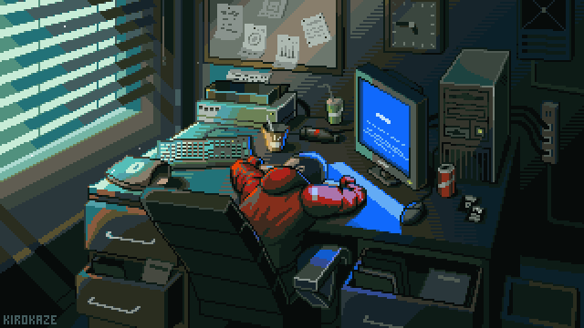

# Harshit Raghuwanshi — Portfolio

**A minimal, motion-rich developer portfolio with a blueprint preloader, a playable football banner, and a handful of playful experiments.**

---

## About

This is the personal portfolio of **Harshit Raghuwanshi**, a Full Stack Developer from Bhopal, India. It showcases projects, experience, open-source work and writing, wrapped in a clean, animated interface with a few surprises along the way.

---

## Highlights

- **Blueprint preloader** that is built from the real page itself
- **Playable pixel football game** in the hero banner
- **Command palette** (Ctrl/⌘ + K) to jump anywhere, switch theme, or copy my email
- **Smooth scrolling** and fluid animations throughout
- **Live GitHub contribution heatmap**
- **Experiments page** full of interactive toys
- **Custom pixel cursor, sound effects, dark and light themes**
- **Fully responsive** on desktop, tablet and mobile

---

## Preloader

> The preloader is inspired by **[imdaryl.com](https://www.imdaryl.com/)**.

Instead of a generic spinner, the loading screen is drawn from the real page:

1. The actual hero is already loaded underneath while the preloader plays.
2. It measures the real elements: navigation, banner, avatar, name, text and buttons.
3. Labelled blueprint wireframes are drawn at exactly those positions while a counter climbs to 100%.
4. The wireframes then turn into ghost text using the real fonts and sizes.
5. A dark sheet wipes away, and the real content is already sitting where the ghost text was.

Huge thanks to [Daryl](https://www.imdaryl.com/) for the inspiration. Go check out his portfolio.

---

## Sections

| Section | What it shows |
| --- | --- |
| **Hero** | Greeting, tagline, availability status and the football banner |
| **About** | Short bio and what I'm currently learning, building and listening to |
| **Projects** | Featured full-stack, frontend and AI projects with live links and source |
| **Experience** | Internship and mentoring roles |
| **Open Source** | Merged pull requests and contributions |
| **Tech Stack** | Skills grouped by category |
| **GitHub Activity** | Contribution heatmap |
| **Writing** | Articles and posts |
| **Contact** | Email, socials and resume |

---

## Experiments

| Experiment | Description |
| --- | --- |
| **Memory Box** | Memories, photos and sounds on a string |
| **Vending Machine** | A vending machine that dispenses items |
| **Harshit Type Motion** | Type that comes alive |
| **The Crowd** | A crowd that forms shapes and dodges a car |
| **404** | A page that is not found, done with style |
| **Year Complete** | A contribution year visualizer |

---

## Built With

- **Framework:** React, TypeScript, Vite, React Router
- **Styling:** Tailwind CSS, Amiamie, Instrument Serif, Inter, JetBrains Mono
- **Animation:** Framer Motion, GSAP, Motion, Lenis, Torph
- **Physics and interaction:** Matter.js, stick-it-up
- **Audio:** Web Kits Audio and custom sound effects
- **Icons:** Lucide, Iconify
- **Analytics and hosting:** Vercel Analytics, Vercel

---

## Featured Projects

| Project | Description | Links |
| --- | --- | --- |
| **LinksHub** | Developer profile and link management platform with AI bios, QR sharing and analytics | [Live](https://linkshub-np0r.onrender.com/) · [Source](https://github.com/harshit403-pixel/LinksHub) |
| **Bidding Wars** | Real-time bidding platform | [Live](https://bidding-wars-skkn.onrender.com/) · [Source](https://github.com/harshit403-pixel/Bidding-Wars) |
| **Voice RAG** | Voice-enabled retrieval-augmented generation system | [Live](https://hhgoa-rag-xlt3.onrender.com/) · [Source](https://github.com/harshit403-pixel/HHGoa-RAG) |
| **RIP VS Code** | Frontend showcase project | [Live](https://rip-vscode.vercel.app/) · [Source](https://github.com/harshit403-pixel/RipVscode) |
| **DevHub** | Developer-focused product | [Live](https://devhub-lemon.vercel.app/) · [Source](https://github.com/harshit403-pixel/DevHub) |
| **Slush** | Animated, modern UI project | [Live](https://slush-xi.vercel.app/) |
| **DeployIt** | Containerized deployment workflows (in progress) | — |

---

## Running It Locally

You'll need Node.js and npm. Clone the repository, install the dependencies, and start the development server. The site will open on a local address shown in your terminal.

All personal content (name, bio, socials, projects, experience) lives in a single configuration file, so making it your own is quick.

---

## Deployment

The site is deployed on **Vercel** and needs no environment variables. Every push to the main branch redeploys it automatically.

---

## Credits

- **Preloader** inspired by [imdaryl.com](https://www.imdaryl.com/)
- Icons by [Lucide](https://lucide.dev/) and [Iconify](https://iconify.design/)
- Smooth scrolling by [Lenis](https://lenis.darkroom.engineering/)

---

## Contact

**Harshit Raghuwanshi** · Full Stack Developer · Bhopal, India

[Portfolio](https://harshits-portfolio.vercel.app) ·
[GitHub](https://github.com/harshit403-pixel) ·
[LinkedIn](https://www.linkedin.com/in/harshit-raghuwanshi-278243281/) ·
[Twitter](https://twitter.com/hrstwt) ·
[Email](mailto:harshuraghu7999@gmail.com)

*If you like this project, a ⭐ on the repo means a lot.*

